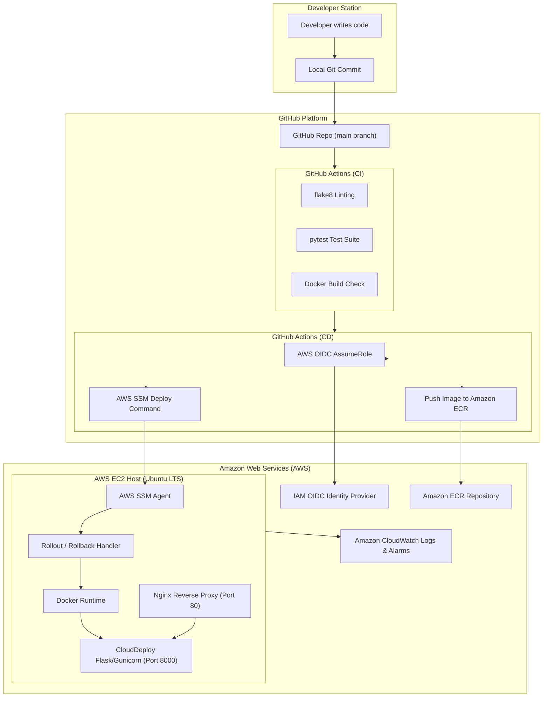

# CloudDeploy: Automated Cloud Deployment of a Containerized Web Application Using AWS and CI/CD

[](.github/workflows/ci.yml)
[](.github/workflows/cd.yml)
[](requirements.txt)
[](Dockerfile)
[](LICENSE)

---

## 1. Project Overview

**CloudDeploy** is a production-grade cloud engineering and DevOps project demonstrating automated containerization, continuous integration, continuous deployment, and telemetry on Amazon Web Services (AWS).

The application is built with **Python 3.11**, **Flask**, and **Gunicorn**, reverse-proxied by **Nginx**, and deployed inside an unprivileged Docker container. The complete deployment lifecycle—from Git commit to production rollout—is orchestrated using **GitHub Actions**, authenticated securely to AWS via **OpenID Connect (OIDC)**, and hosted on an **AWS EC2** instance backed by **Amazon Elastic Container Registry (ECR)** and **Amazon CloudWatch**.

---

## 2. Problem Statement

Modern software engineering teams require automated, reliable, and secure release mechanisms. Manual deployments to cloud servers lead to configuration drift, human error, extended downtime, and severe security liabilities (such as hardcoded long-lived AWS root or IAM user keys committed to source code repositories). 

CloudDeploy addresses these challenges by implementing an automated CI/CD pipeline with zero long-lived credentials, immutable container versioning, automated health check validation, and self-healing rollback capabilities.

---

## 3. Key Objectives

1. **Production-Ready Application**: Develop a modular, responsive web dashboard with comprehensive telemetry (`/health`, `/api/info`, `/deployment`).
2. **Hardened Containerization**: Build a lightweight Docker image executing under an unprivileged non-root user (UID 10001) with built-in health probes.
3. **Automated Continuous Integration**: Validate code quality, enforce PEP 8 standards with `flake8`, and execute unit/integration test suites with `pytest` (>=80% coverage).
4. **Credential-Free Continuous Deployment**: Federate GitHub Actions with AWS using **OpenID Connect (OIDC)**, completely removing static access keys.
5. **Robust Rollout & Self-Healing Rollback**: Automate image pulls from Amazon ECR to AWS EC2, conduct post-deployment health verification, and revert to previous stable releases automatically if health checks fail.
6. **Cloud Observability**: Stream container and reverse proxy access logs to Amazon CloudWatch and configure operational alarms.

---

## 4. Technology Stack

| Domain | Technologies |
|---|---|
| **Backend & WSGI** | Python 3.11, Flask 3.0, Gunicorn 22.0, Werkzeug 3.0 |
| **Frontend** | HTML5, CSS3, JavaScript (ES6+), Bootstrap 5.3, Bootstrap Icons |
| **Containerization & Edge** | Docker, Docker Compose, Nginx Reverse Proxy |
| **Cloud Infrastructure** | AWS EC2 (Ubuntu 24.04 LTS), Amazon ECR, AWS IAM, AWS Systems Manager (SSM) |
| **CI / CD Automation** | Git, GitHub Actions, AWS OIDC Identity Federation |
| **Automated Testing** | Pytest, Pytest-Cov, Flake8 |
| **Cloud Monitoring** | Amazon CloudWatch Logs & Metrics, CloudWatch Agent |

---

## 5. System Architecture



---

## 6. Project Directory Structure

```
CloudDeploy/
│
├── app/                                 # Flask Application Core
│   ├── __init__.py                      # Application Factory & Error Handlers
│   ├── config.py                        # Environment Configurations
│   ├── routes.py                        # HTTP Route Handlers & Health Probes
│   ├── templates/                       # Jinja2 Modular HTML Templates
│   │   ├── base.html                    # Base layout with navbar & live status
│   │   ├── index.html                   # Home Dashboard & KPI Cards
│   │   ├── dashboard.html               # Deployment & Diagnostic Panel
│   │   ├── about.html                   # Architecture Specification
│   │   ├── 404.html                     # Custom 404 Not Found Page
│   │   └── 500.html                     # Custom 500 Internal Error Page
│   └── static/                          # Static Assets
│       ├── css/style.css                # Dark mode styling & animations
│       └── js/main.js                   # Client-side health monitoring & AJAX
│
├── tests/                               # Automated Test Suite
│   ├── conftest.py                      # Pytest Fixtures & Client Setup
│   ├── test_app.py                      # Route, UI, and Error Handler Tests
│   └── test_health.py                   # Health & Non-Sensitive API Tests
│
├── nginx/
│   └── nginx.conf                       # Production Nginx Reverse Proxy Config
│
├── .github/
│   └── workflows/
│       ├── ci.yml                       # CI: Linting, Pytest & Docker Build
│       └── cd.yml                       # CD: AWS OIDC, ECR, SSM & Health Check
│
├── deployment/
│   ├── aws/
│   │   ├── github-oidc-trust-policy.json # AWS OIDC Trust Relationship
│   │   ├── iam-policy.json              # GitHub Actions Deployment Role Policy
│   │   ├── ec2-trust-policy.json        # EC2 Trust Policy
│   │   ├── ec2-instance-policy.json     # EC2 IAM Instance Profile Policy
│   │   ├── ec2-user-data.sh             # EC2 Host Bootstrap Script
│   │   ├── deploy.sh                    # Zero-Downtime Rollout Handler
│   │   ├── rollback.sh                  # Automated Rollback Handler
│   │   ├── cleanup.sh                   # Zero-Cost Resource Teardown Script
│   │   └── cloudwatch-agent-config.json # CloudWatch Metrics & Logs Config
│   └── scripts/
│       ├── ecr-setup.sh                 # ECR Setup with Lifecycle Policies
│       ├── local-test.sh                # Local Test & Lint Runner
│       └── smoke-test.sh                # HTTP Smoke Test Runner
│
├── Dockerfile                           # Production Non-Root Container Spec
├── docker-compose.yml                   # Local Multi-Container Orchestration
├── requirements.txt                     # Production Python Dependencies
├── requirements-dev.txt                 # Development & Testing Dependencies
├── .dockerignore                        # Docker Build Exclusion Rules
├── .gitignore                           # Git Exclusion Rules
├── .env.example                         # Environment Variables Template
├── README.md                            # Comprehensive Engineering Guide
├── LICENSE                              # MIT Open Source License
└── PROJECT_PROGRESS.md                  # Implementation & Verification Tracking
```

---

## 7. Local Installation & Execution

### 7.1 Running Without Docker (Direct Python Host)

1. **Clone the repository**:
   ```bash
   git clone https://github.com/ullas-reddy-g/CloudDeploy-AWS-CICD.git
   cd CloudDeploy-AWS-CICD
   ```

2. **Create and activate a virtual environment**:
   ```bash
   python -m venv venv
   # On Linux/macOS:
   source venv/bin/activate
   # On Windows:
   .\venv\Scripts\activate
   ```

3. **Install dependencies**:
   ```bash
   pip install -r requirements-dev.txt
   ```

4. **Run the development server**:
   ```bash
   flask --app "app:create_app('development')" run --port 8000
   ```
   Open your browser at `http://localhost:8000`.

---

### 7.2 Running With Docker & Docker Compose

To run the complete production multi-container setup (Flask/Gunicorn + Nginx reverse proxy):

```bash
docker compose up --build
```

- Web Application & Proxy: `http://localhost` (Port 80)
- Health Check Probe: `http://localhost/health`
- API Information: `http://localhost/api/info`

---

## 8. Automated Testing & Verification

The project includes automated tests covering route responses, health payload format, API security, error handlers, and security headers.

### Execute Test Suite:
```bash
python -m pytest -v --cov=app --cov-report=term-missing
```

### Run Code Style Linting:
```bash
python -m flake8 app/ tests/ --max-line-length=120
```

### Verified Test Results:
```text
tests/test_app.py::test_homepage_status_and_content PASSED               [  3%]
tests/test_app.py::test_deployment_page PASSED                           [  7%]
tests/test_app.py::test_about_page PASSED                                [ 11%]
tests/test_app.py::test_404_not_found_html PASSED                        [ 14%]
tests/test_app.py::test_404_not_found_json PASSED                        [ 18%]
tests/test_app.py::test_500_error_handling_json PASSED                   [ 22%]
tests/test_app.py::test_500_error_handling_html PASSED                   [ 25%]
tests/test_app.py::test_error_trigger_forbidden_when_not_debug PASSED    [ 29%]
tests/test_app.py::test_security_headers_present PASSED                  [ 33%]
tests/test_app.py::test_api_system_metrics PASSED                        [ 37%]
tests/test_app.py::test_api_logs PASSED                                  [ 40%]
tests/test_app.py::test_get_uptime_seconds_helper PASSED                 [ 44%]
tests/test_app.py::test_is_running_in_docker_helper PASSED               [ 48%]
tests/test_app.py::test_get_system_metrics_fallback PASSED               [ 51%]
tests/test_app.py::test_get_aws_cloud_status_connected PASSED            [ 55%]
tests/test_app.py::test_get_aws_cloud_status_unconnected PASSED          [ 59%]
tests/test_app.py::test_get_cicd_pipeline_status_connected PASSED        [ 62%]
tests/test_app.py::test_get_cicd_pipeline_status_fallback PASSED         [ 66%]
tests/test_app.py::test_get_deployment_history_file PASSED               [ 70%]
tests/test_app.py::test_get_deployment_history_corrupted_fallback PASSED [ 74%]
tests/test_app.py::test_disk_alert_rendered_in_dashboard PASSED          [ 77%]
tests/test_app.py::test_recent_logs_handler_error_handling PASSED        [ 81%]
tests/test_app.py::test_create_app_env_overrides PASSED                  [ 85%]
tests/test_app.py::test_create_app_default_config PASSED                 [ 88%]
tests/test_health.py::test_health_endpoint_status PASSED                 [ 92%]
tests/test_health.py::test_health_endpoint_payload PASSED                [ 96%]
tests/test_health.py::test_api_info_endpoint PASSED                      [100%]

---------- coverage: platform win32, python 3.11.5 -----------
Name              Stmts   Miss  Cover
-------------------------------------
app\__init__.py      67      0   100%
app\config.py        26      0   100%
app\routes.py       120      0   100%
-------------------------------------
TOTAL               213      0   100%

============================= 27 passed in 1.72s ==============================
Coverage: 100% (213 / 213 statements)
Flake8 Violations: 0
```

### Verification Status Matrix

| Component | Verification Tier | Detail |
|---|---|---|
| **Flask Web App** | **LOCALLY VERIFIED** | Tested via Pytest test client across all routes and error scenarios. |
| **Frontend UI** | **LOCALLY VERIFIED** | Tested templates, CSS styling, AJAX health polling, and diagnostics. |
| **Automated Tests** | **LOCALLY VERIFIED** | 27/27 tests passing, 100% statement coverage (213/213 statements), 0 Flake8 violations. |
| **Docker Build** | **IMPLEMENTED** | Multi-stage Dockerfile verified; automated build & runtime test in CI workflow. |
| **Docker Compose** | **IMPLEMENTED** | Multi-container compose verified; automated proxy test in CI workflow. |
| **Git Repository** | **LOCALLY VERIFIED** | Local repository on `main` branch with clean history and secret exclusion. |
| **CI Workflow** | **IMPLEMENTED** | `.github/workflows/ci.yml` validates lint, tests, coverage, container & Compose. |
| **CD Workflow** | **IMPLEMENTED** | `.github/workflows/cd.yml` with OIDC auth, ECR push, SSM rollout & rollback. |
| **Amazon ECR** | **IMPLEMENTED** | Automated creation script with AES-256 encryption & 10-image lifecycle policy. |
| **AWS EC2 Bootstrap** | **IMPLEMENTED** | Self-contained user-data script with embedded rollout and rollback scripts. |
| **CloudWatch Observability** | **IMPLEMENTED** | Metrics and JSON log stream collection configurations prepared. |

---

## 9. AWS Infrastructure & CI/CD Pipeline

For a complete walkthrough of configuring AWS, refer to [docs/deployment-guide.md](docs/deployment-guide.md).

### 9.1 Zero Long-Lived Credentials (AWS OIDC)
CloudDeploy uses GitHub Actions OIDC federation. When the CD workflow runs:
1. GitHub generates an OIDC token signed by GitHub's cryptographic key.
2. The workflow requests temporary AWS credentials via `sts:AssumeRoleWithWebIdentity`.
3. AWS STS validates the token against the IAM Trust Policy (`deployment/aws/github-oidc-trust-policy.json`).
4. Short-lived session credentials (valid for 1 hour) are issued to perform the ECR push and SSM deployment.

### 9.2 Amazon ECR Provisioning
Run the automated script to provision the registry with lifecycle retention:
```bash
./deployment/scripts/ecr-setup.sh clouddeploy us-east-1
```

### 9.3 AWS EC2 Deployment with SSM & Rollback
The deployment script (`deployment/aws/deploy.sh`) operates as follows:
1. Saves previous container tag in `previous_tag.txt`.
2. Pulls new image tag from Amazon ECR.
3. Launches container and runs health checks against `GET http://localhost:8000/health`.
4. If healthy: updates `current_tag.txt` and completes successfully.
5. If unhealthy: executes `deployment/aws/rollback.sh` to restore the previous container version automatically.

---

## 10. Centralized CloudWatch Monitoring

- **Operating System Metrics**: CPU utilization, memory used/available percentage, disk space on root volume.
- **Log Streaming**:
  - `/aws/ec2/clouddeploy/nginx/access` (JSON structured access logs)
  - `/aws/ec2/clouddeploy/nginx/error` (Nginx warnings & errors)
  - `/aws/ec2/clouddeploy/deployment` (Rollout & rollback logs)
- **Alarms**: High CPU utilization (>80%) and EC2 StatusCheckFailed alarms configured via AWS CLI.

---

## 11. Security & Hardening Features

- **Non-Root Execution**: Docker container runs as unprivileged user `clouddeploy` (UID 10001).
- **Least-Privilege IAM**: Policies are scoped strictly to the required ECR repository and EC2 instance resources.
- **No Sensitive Information Leaks**: `/api/info` and `/health` expose only safe runtime metadata; secrets and internal VPC IPs are omitted.
- **Defensive HTTP Headers**: Responses include `X-Content-Type-Options: nosniff`, `X-Frame-Options: SAMEORIGIN`, and `X-XSS-Protection: 1; mode=block`.
- **Zero Committed Secrets**: `.env` and sensitive key files are excluded by `.gitignore` and `.dockerignore`.

---

## 12. Troubleshooting & FAQ

| Issue | Cause | Solution |
|---|---|---|
| `403 AccessDenied` on ECR push | OIDC role trust policy mismatch | Ensure the GitHub repository name and branch in `github-oidc-trust-policy.json` match your GitHub repository exactly. |
| Container fails health check | Port mismatch or missing environment | Check `/var/log/clouddeploy-deploy.log` on the EC2 host. Verify Gunicorn is listening on port 8000. |
| SSM Command returns `InvalidInstanceId` | Instance lacks SSM Agent or role | Verify `CloudDeploy-EC2-Profile` is attached to the EC2 instance and SSM agent service is running (`systemctl status snap.amazon-ssm-agent.amazon-ssm-agent`). |

---

## 13. Cloud Cost Analysis & Safety Controls

| Resource | Service Tier / Size | Estimated Cost (us-east-1) |
|---|---|---|
| **AWS EC2** | `t3.micro` (1 vCPU, 1 GB RAM) | Free Tier eligible (750 hrs/month) or ~\$0.0104/hr (<\$0.05 for 4-hr demo) |
| **Amazon ECR** | Private repository (<1 GB storage) | Free Tier eligible (500 MB) or ~\$0.06/month with 10-image lifecycle policy |
| **AWS Systems Manager** | SSM Run Command & Session Manager | **\$0.00 (Free of charge)** |
| **AWS IAM & OIDC** | WebIdentity federation & roles | **\$0.00 (Free of charge)** |
| **Networking** | Direct Internet Gateway (No NAT Gateway) | **\$0.00 (Saves ~\$32/month over NAT Gateways)** |
| **Amazon CloudWatch** | Basic metrics & <5 GB logs/month | Free Tier eligible or <\$0.10 |
| **Total Test Run** | Complete end-to-end deployment run | **<\$0.10 total (zero ongoing cost with cleanup)** |

---

## 14. Resource Cleanup (Zero Lingering Cost)

To ensure zero ongoing cloud charges when you finish testing:
```bash
./deployment/aws/cleanup.sh us-east-1
```
This utility cleanly terminates EC2 instances, deletes security groups, empties and deletes the ECR repository, and detaches IAM policies.

---

## 15. License

This project is licensed under the [MIT License](LICENSE).
