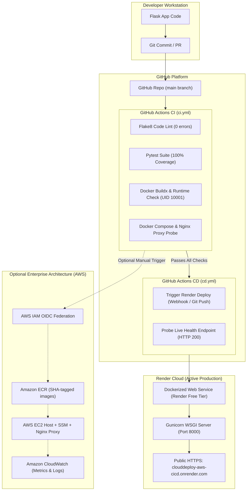

# CloudDeploy: Automated Cloud Deployment of a Containerized Web Application Using Docker, Render & CI/CD

[](https://github.com/ullas-reddy-g/CloudDeploy-AWS-CICD/actions)
[](.github/workflows/cd.yml)
[](https://clouddeploy-aws-cicd.onrender.com)
[](requirements.txt)
[-2496ed?style=for-the-badge&logo=docker&logoColor=white)](Dockerfile)
[](docs/TESTING.md)
[](LICENSE)

---

## 1. Project Overview

**CloudDeploy** is a production-grade cloud engineering and DevOps project demonstrating automated containerization, continuous integration, continuous delivery, and real-time observability.

The application is built with **Python 3.11**, **Flask**, and **Gunicorn**, containerized with **Docker**, reverse-proxied by **Nginx**, and deployed live on **Render Cloud**. The complete lifecycle—from Git commit to production health verification—is orchestrated via **GitHub Actions** and Render automated deployment. Production-grade **AWS infrastructure artifacts** (ECR, EC2 user-data, IAM OIDC policies, CloudWatch agent) are also provided as an optional enterprise extension.

- **Live Production Application:** [https://clouddeploy-aws-cicd.onrender.com](https://clouddeploy-aws-cicd.onrender.com)
- **Monitoring & Telemetry Dashboard:** [https://clouddeploy-aws-cicd.onrender.com/deployment](https://clouddeploy-aws-cicd.onrender.com/deployment)
- **GitHub Repository:** [https://github.com/ullas-reddy-g/CloudDeploy-AWS-CICD](https://github.com/ullas-reddy-g/CloudDeploy-AWS-CICD)

---

## 2. Problem Statement

Modern software engineering teams face critical risks when deploying applications manually:
- **Configuration Drift & Downtime:** Inconsistent server setups and manual updates lead to runtime discrepancies and deployment failures.
- **Credential Liabilities:** Storing long-lived cloud access keys or secrets in codebases creates severe security vulnerabilities.
- **Opaque Deployments & False Metrics:** Engineering dashboards often present fabricated or hardcoded telemetry rather than querying real upstream build APIs and runtime health probes.

CloudDeploy solves these challenges through an end-to-end automated pipeline with zero hardcoded credentials, 100% test coverage enforcement, hardened non-root containerization, automated deployment triggers, and honest telemetry linked directly to the GitHub Actions REST API.

---

## 3. Key Objectives

1. **Production-Ready Application:** Modular Flask web application with responsive Bootstrap 5 UI, health check probes (`/health`), non-sensitive metadata (`/api/info`), and consolidated telemetry (`/deployment`).
2. **Hardened Containerization:** Lightweight Docker image based on `python:3.11-slim`, executing strictly under an unprivileged user (`clouddeploy` UID 10001) with internal Python health probes.
3. **Automated Continuous Integration (CI):** GitHub Actions workflow executing Flake8 style enforcement (0 violations), Pytest test suite with **100% statement coverage (359/359 statements)**, Docker build verification, non-root user verification, and Docker Compose reverse proxy validation.
4. **Automated Continuous Deployment (CD):** Continuous delivery to Render Cloud via native Git-push integration and secured deploy hooks with post-rollout health check validation.
5. **Real Upstream Telemetry:** Live dashboard querying the official GitHub Actions REST API for recent workflow runs, durations, and conclusions, alongside real-time sanitized log streaming.
6. **Enterprise Architecture Extension:** Complete AWS infrastructure automation code (IAM OIDC, Amazon ECR, EC2 user-data bootstrap, CloudWatch agent configuration) for enterprise cloud deployment demonstration.

---

## 4. Technology Stack

| Domain | Technologies | Purpose |
|---|---|---|
| **Backend & WSGI** | Python 3.11, Flask 3.0.3, Gunicorn 22.0.0, Werkzeug 3.0.3 | Application factory pattern, REST APIs, WSGI process management |
| **Frontend UI** | HTML5, CSS3, JavaScript (ES6+), Bootstrap 5.3, Bootstrap Icons | Responsive monitoring dashboard, AJAX polling, live log streaming |
| **Containerization** | Docker Engine, Dockerfile (UID 10001), Docker Compose v2 | Multi-stage caching, unprivileged execution, container orchestration |
| **Edge Reverse Proxy** | Nginx Alpine | Port 80 ingress, security headers, request buffering, CloudWatch JSON logs |
| **CI Automation** | GitHub Actions (`ci.yml`) | Flake8 linting, Pytest 100% coverage, Docker Buildx, Compose runtime test |
| **CD Automation** | GitHub Actions (`cd.yml`) & Render | Automated deployment triggers and health check verification |
| **Production Hosting** | Render Cloud (Free Tier) | Public HTTPS web service at `https://clouddeploy-aws-cicd.onrender.com` |
| **Automated Testing** | Pytest 8.2.2, pytest-cov 5.0.0, Flake8 7.1.0 | 37 automated tests, 100% statement coverage, 0 Flake8 errors |
| **Enterprise Extension** | AWS (ECR, EC2, IAM OIDC, SSM, CloudWatch) | Optional enterprise cloud infrastructure artifacts in `deployment/aws/` |

---

## 5. System Architecture Diagram



---

## 6. Directory Structure

```
CloudDeploy/
├── .github/
│   └── workflows/
│       ├── ci.yml                       # CI: Linting, Pytest (100% Coverage), Docker Build & Compose Probe
│       ├── cd.yml                       # CD: Render Cloud Automated Deployment & Health Verification
│       └── aws-deploy-optional.yml      # Optional: Manual AWS OIDC, ECR & EC2 SSM Deployment Workflow
│
├── app/
│   ├── __init__.py                      # Flask Application Factory & Security Headers
│   ├── config.py                        # Multi-Environment Configuration Management
│   ├── routes.py                        # REST API Endpoints, Telemetry & Dashboard Logic
│   ├── static/
│   │   ├── css/style.css                # Dark-Mode Modern Bootstrap Styling
│   │   └── js/main.js                   # Client-Side AJAX Health & Log Stream Poller
│   └── templates/
│       ├── base.html                    # Base Template with Navigation & Footer
│       ├── index.html                   # Home Dashboard & Quick Status KPI Cards
│       ├── dashboard.html               # Comprehensive Monitoring Dashboard (Sections A-H)
│       ├── about.html                   # Architecture & Security Specification Page
│       ├── 404.html                     # Custom 404 Not Found Page
│       └── 500.html                     # Custom 500 Internal Error Page
│
├── deployment/
│   ├── aws/                             # Optional Enterprise AWS Infrastructure Code
│   │   ├── github-oidc-trust-policy.json# AWS IAM OIDC Trust Relationship
│   │   ├── iam-policy.json              # GitHub Actions Deployment Role Policy
│   │   ├── ec2-trust-policy.json        # EC2 Trust Policy
│   │   ├── ec2-instance-policy.json     # EC2 IAM Instance Profile Policy
│   │   ├── ec2-user-data.sh             # EC2 Host Bootstrap Script (Docker + Nginx + SSM)
│   │   ├── deploy.sh                    # Zero-Downtime Rollout Handler
│   │   ├── rollback.sh                  # Automated Rollback Handler
│   │   ├── cleanup.sh                   # Zero-Cost Resource Teardown Script
│   │   └── cloudwatch-agent-config.json # CloudWatch Metrics & Logs Config
│   └── scripts/
│       ├── ecr-setup.sh                 # Amazon ECR Automated Provisioning Script
│       ├── local-test.sh                # Local Virtualenv Test Runner
│       └── smoke-test.sh                # HTTP Probe Smoke Test Utility
│
├── docs/
│   ├── ARCHITECTURE.md                  # Comprehensive System Architecture Specification
│   ├── DEPLOYMENT.md                    # Production Render & Local Docker Deployment Guide
│   ├── TESTING.md                       # Test Strategy, Categories & 100% Coverage Matrix
│   ├── SECURITY.md                      # Security Audit, Non-Root UID & OIDC Specification
│   └── screenshots/
│       └── README.md                    # Visual Evidence Catalog & Screenshot Instructions
│
├── nginx/
│   └── nginx.conf                       # Production Nginx Reverse Proxy Configuration
│
├── tests/
│   ├── conftest.py                      # Pytest Fixtures & Flask Test Client Setup
│   ├── test_app.py                      # Routes, APIs, Telemetry, Cache & Error Tests
│   └── test_health.py                   # Health & Non-Sensitive API Tests
│
├── .dockerignore                         # Docker Build Exclusion Rules
├── .env.example                         # Environment Variables Template
├── .gitignore                           # Git Exclusion Rules (Secrets, Caches, Venv)
├── docker-compose.yml                   # Multi-Container Orchestration (App + Nginx)
├── Dockerfile                           # Hardened Multi-Stage Dockerfile (UID 10001)
├── LICENSE                              # MIT License
├── pytest.ini                           # Pytest Configuration (pythonpath = .)
├── requirements.txt                     # Production Runtime Dependencies
└── requirements-dev.txt                 # Development, Linting & Testing Dependencies
```

---

## 7. Local Installation Instructions

### Prerequisites
- Python 3.11+
- Git 2.30+
- Docker & Docker Compose (optional for container testing)

### Step-by-Step Setup
```powershell
# 1. Clone repository
git clone https://github.com/ullas-reddy-g/CloudDeploy-AWS-CICD.git
cd CloudDeploy

# 2. Create and activate a Python virtual environment
python -m venv venv
.\venv\Scripts\Activate.ps1    # On Windows
# source venv/bin/activate      # On Linux/macOS

# 3. Install dependencies
python -m pip install --upgrade pip
pip install -r requirements-dev.txt
```

---

## 8. Running Flask Locally

Start the local development server:
```powershell
python -c "from app import create_app; app = create_app('development'); app.run(host='0.0.0.0', port=8000, debug=True)"
```
Open your browser at: `http://localhost:8000`.

---

## 9. Docker Build and Run Commands

Build and run the application using the production Dockerfile:
```bash
# Build the Docker image
docker build -t clouddeploy:latest .

# Run the container in the background
docker run -d --name clouddeploy-app -p 8000:8000 clouddeploy:latest

# Probe the container health endpoint
curl -i http://localhost:8000/health

# Verify unprivileged user execution (UID 10001)
docker exec clouddeploy-app id -u
# Returns: 10001

# Inspect container logs
docker logs clouddeploy-app

# Clean up
docker stop clouddeploy-app && docker rm clouddeploy-app
```

---

## 10. Docker Compose Instructions

Run the full multi-container production stack including Nginx reverse proxy:
```bash
# Start all services with automated build
docker compose up -d --build

# View container status and health dependencies
docker compose ps

# Probe the Nginx edge reverse proxy on port 80
curl -i http://localhost:80/health

# View live reverse proxy and application logs
docker compose logs -f

# Shut down and remove containers and network
docker compose down
```

---

## 11. GitHub Actions CI/CD Pipeline

The Continuous Integration pipeline ([`.github/workflows/ci.yml`](.github/workflows/ci.yml)) automatically triggers on every push and pull request targeting the `main` branch.

### CI Stages
1. **Lint & Pytest Suite:**
   - Checks out code with `actions/checkout@v4`.
   - Configures Python 3.11 with pip caching via `actions/setup-python@v5`.
   - Runs Flake8 syntax checks and PEP8 style enforcement with 0 allowed errors.
   - Executes Pytest with mandatory 80% coverage threshold (**100% statement coverage achieved**).
2. **Container Build & Runtime Verification (`needs: lint-and-test`):**
   - Builds container image with `docker/build-push-action@v5`.
   - Starts standalone container and validates HTTP 200 on `/health`.
   - Asserts non-root user execution (`UID 10001`).
   - Launches Docker Compose orchestration (Web + Nginx) and validates reverse proxy connectivity on port 80.
   - Cleans up all testing containers.

---

## 12. Render Cloud Deployment Instructions

The Continuous Deployment pipeline ([`.github/workflows/cd.yml`](.github/workflows/cd.yml)) runs automatically after the CI pipeline succeeds.

### Deployment Workflow
1. **Automatic Git-Push Rollout:** Render detects pushes to `main` and automatically builds and deploys the container.
2. **CI-Gated Deploy Hook (Optional):** If secret `RENDER_DEPLOY_HOOK` is configured, GitHub Actions triggers the deployment hook via POST request and probes `https://clouddeploy-aws-cicd.onrender.com/health` to confirm rollout.

---

## 13. Environment Variables Reference

| Variable | Default Value | Description |
|---|---|---|
| `ENVIRONMENT` | `production` | Active environment profile (`production`, `development`, `testing`) |
| `PORT` | `8000` | Application HTTP listening port |
| `APP_NAME` | `CloudDeploy` | User-facing application branding name |
| `APP_VERSION` | `1.0.0` | Semantic release version |
| `HOSTING_PROVIDER` | `render` (in cloud) / `local` | Host platform indicator displayed on dashboard |
| `RENDER_EXTERNAL_URL` | `https://clouddeploy-aws-cicd.onrender.com` | Public production application URL |
| `RENDER_GIT_COMMIT` | `local-build` | Git commit SHA automatically injected by Render runtime |
| `GITHUB_REPOSITORY` | `ullas-reddy-g/CloudDeploy-AWS-CICD` | Repository used for GitHub Actions API telemetry |
| `GITHUB_TOKEN` | *(Optional)* | Personal access token for higher GitHub API rate limits |
| `RENDER_API_KEY` | *(Optional)* | Render REST API key for deployment history integration |
| `RENDER_SERVICE_ID` | *(Optional)* | Render Web Service ID for deployment history queries |

---

## 14. Dashboard Functionality

The monitoring dashboard ([`/deployment`](https://clouddeploy-aws-cicd.onrender.com/deployment)) provides structured operational insights across eight dedicated sections:

- **Section A: System Overview:** Service health badge, hosting provider, active commit tag, and uptime.
- **Section B: Docker Container Monitoring:** Execution mode, unprivileged non-root user (UID 10001), WSGI worker threads, and memory usage.
- **Section C: Cloud Infrastructure Diagnostics:** Render production host status and optional AWS architecture reference.
- **Section D: CI/CD Automation Pipeline:** Real-time GitHub Actions telemetry querying the official GitHub REST API (workflow names, branches, commit SHAs, status, conclusion, and run duration).
- **Section E: Deployment History:** Real-time Render deployment status and filesystem deployment records.
- **Section F: Recent Application Logs:** In-memory ring buffer log stream with automatic credential redaction.
- **Section G: Real-Time Alerts:** Automated evaluations of storage capacity (>85%), CI build results, and container execution.
- **Section H: Architecture & Topology Flow:** End-to-end visual diagram showing code progression from developer commit to live Render hosting.

---

## 15. REST API Documentation

| Method | Endpoint | Description | Sample Output |
|---|---|---|---|
| `GET` | `/health` | Container and load-balancer health probe | `{"status": "healthy", "version": "1.0.0", "uptime_seconds": 120, "timestamp": "..."}` |
| `GET` | `/api/info` | Non-sensitive operational metadata | `{"app_name": "CloudDeploy", "environment": "production", "status": "operational", ...}` |
| `GET` | `/api/github/workflows` | Live GitHub Actions workflow telemetry | `{"integration_status": "connected", "workflow_runs": [...], "rate_limit_remaining": "59"}` |
| `GET` | `/api/deployments` | Render deployment status & history | `{"integration_status": "unconfigured", "provider": "Render", "deployments": [...]}` |
| `GET` | `/api/monitoring` | Consolidated system & container metrics | `{"system": {...}, "docker": {...}, "hosting": {...}, "status": "healthy"}` |
| `GET` | `/api/system-metrics` | Hardware storage and CPU statistics | `{"system": {"disk_used_pct": 42.1, "cpu_count": 4}, "uptime_seconds": 120}` |
| `GET` | `/api/logs` | Sanitized in-memory log stream | `{"logs": [{"timestamp": "...", "level": "INFO", "message": "..."}], "count": 10}` |
| `GET` | `/api/alerts` | Active evaluated alerts list | `{"alerts": [...], "count": 1}` |

---

## 16. Testing Instructions

Execute the complete test suite locally:
```powershell
# Run all 37 tests with statement coverage
python -m pytest -v --cov=app --cov-report=term-missing

# Run style and PEP8 quality checks
python -m flake8 app/ tests/ --count --max-line-length=120 --statistics
```
See [docs/TESTING.md](docs/TESTING.md) for full coverage breakdown.

---

## 17. Security Features

- **Zero Hardcoded Secrets:** No API keys, AWS credentials, or tokens stored in source code.
- **Non-Root Execution:** Dedicated user `clouddeploy` (UID 10001) in Dockerfile.
- **Log Scrubbing:** Automatic redaction of sensitive environment tokens in `/api/logs`.
- **Security Headers:** Injected `X-Frame-Options`, `X-Content-Type-Options`, and `X-XSS-Protection`.
- **Protected Endpoints:** Debug and test-trigger routes strictly forbidden in production.
See [docs/SECURITY.md](docs/SECURITY.md) for detailed audit results.

---

## 18. Known Limitations

- **Render Free Tier Cold Starts:** Free tier web services spin down after 15 minutes of inactivity; initial requests after idle may take 30–50 seconds to warm up.
- **GitHub API Rate Limits:** Unauthenticated public requests to GitHub Actions API are limited to 60 requests per hour per IP. CloudDeploy implements an in-memory 30-second cache to prevent rate-limiting.
- **Container Host Metrics on PaaS:** Operating system memory and CPU percentages are restricted by container sandboxes on serverless/PaaS platforms and are reported honestly as "unavailable".

---

## 19. Project Evidence & Screenshots

Visual validation evidence is cataloged in [`docs/screenshots/`](docs/screenshots/README.md):
- `dashboard.png`: Live production monitoring dashboard.
- `deployment-info.png`: API metadata and health probe responses.
- `architecture.png`: Architecture specification and security strategy.
- `github-actions-ci.png`: Passing GitHub Actions CI pipeline execution.
- `render-live-deployment.png`: Render Cloud Web Service deployment console.
- `docker-runtime.png`: Local Docker Compose and Nginx reverse proxy verification.

---

## 20. Future Enhancements

1. **Prometheus & Grafana:** Integrate Prometheus metrics exporter on `/metrics` for enterprise dashboarding.
2. **Kubernetes Helm Charts:** Author Kubernetes Helm charts for deployment on AWS EKS or Minikube.
3. **Automated Dynamic Secret Rotation:** Integrate HashiCorp Vault or AWS Secrets Manager for ephemeral database credentials.
