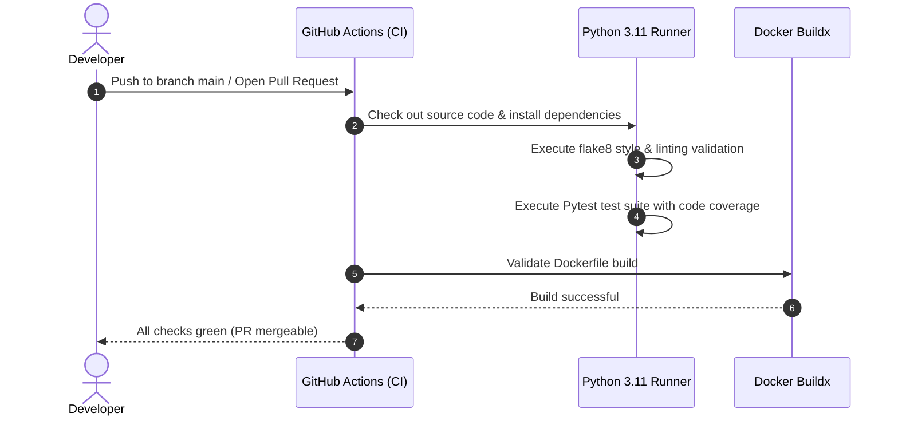
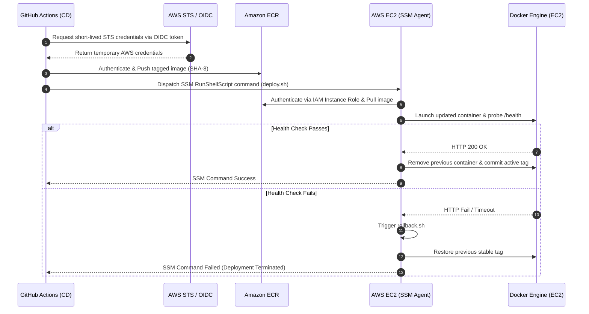

# CloudDeploy - System Architecture & Engineering Specification

## 1. Architectural Overview

CloudDeploy is an enterprise-grade cloud automation platform designed to deliver containerized web applications reliably to Amazon Web Services (AWS) using modern DevOps and Continuous Integration/Continuous Deployment (CI/CD) practices.

The system decouples developer workflows from manual infrastructure operations, providing an automated path from code commit to a secured, monitored EC2 deployment behind an Nginx reverse proxy.

```mermaid
flowchart TD
    subgraph Developer_Workstation["Developer Environment"]
        DevCode["Python 3.11 / Flask App"]
        GitRepo["Git Local Repository"]
    end

    subgraph GitHub_Ecosystem["GitHub Platform"]
        GHPush["GitHub Repository (main branch)"]
        subgraph GHA_CI["GitHub Actions CI Pipeline"]
            Lint["flake8 Linting"]
            Tests["Pytest Test Suite (>=80% cov)"]
            DockerVerify["Docker Build Verification"]
        end
        subgraph GHA_CD["GitHub Actions CD Pipeline"]
            OIDCAuth["AWS OIDC AssumeRole"]
            ECRBuildPush["Docker Build & Tag (SHA/latest)"]
            SSMDispatch["AWS SSM Send-Command"]
            HealthCheckProbe["Automated Health Check"]
        end
    end

    subgraph AWS_Cloud["Amazon Web Services (AWS)"]
        subgraph IAM_Security["Identity & Access Management"]
            OIDCProvider["OIDC Identity Provider (GitHub)"]
            DeployRole["Deployment Role (Least-Privilege)"]
            EC2Role["EC2 Instance Profile"]
        end

        subgraph Container_Registry["Amazon ECR"]
            ECRRepo["ECR Repository: clouddeploy"]
            LifecyclePolicy["Lifecycle Policy (Retain 10 Images)"]
        end

        subgraph Compute_Tier["AWS EC2 Host (Ubuntu LTS)"]
            SSMAgent["AWS Systems Manager Agent"]
            NginxProxy["Nginx Reverse Proxy (Port 80)"]
            DockerEngine["Docker Engine (Container Runtime)"]
            AppContainer["Gunicorn + Flask Container (Port 8000)"]
            DeployScript["Rollout & Rollback Scripts"]
        end

        subgraph Observability["Amazon CloudWatch"]
            Metrics["EC2 Metrics (CPU, RAM, Disk)"]
            Logs["Container & Nginx Access/Error Logs"]
            Alarms["Health & Utilization Alarms"]
        end
    end

    DevCode --> GitRepo
    GitRepo --> GHPush
    GHPush --> GHA_CI
    GHA_CI --> GHA_CD

    OIDCAuth --> OIDCProvider
    OIDCProvider --> DeployRole
    ECRBuildPush --> ECRRepo
    SSMDispatch --> SSMAgent

    SSMAgent --> DeployScript
    DeployScript --> ECRRepo
    DeployScript --> DockerEngine
    DockerEngine --> AppContainer
    NginxProxy --> AppContainer

    Compute_Tier --> Observability
```



---

## 2. Component Specifications

### 2.1 Web Application Tier
- **Framework**: Flask 3.0+ utilizing the Application Factory pattern (`create_app()`).
- **WSGI Server**: Gunicorn 22.0 configured with multi-worker pre-fork concurrency (`--workers 3 --threads 2`).
- **Configuration Management**: Decoupled environment classes (`DevelopmentConfig`, `ProductionConfig`, `TestingConfig`).
- **Structured Logging**: Standardized timestamped logging to standard output (`stdout`), formatted for CloudWatch log driver compatibility.
- **Security Headers**: Standard defense-in-depth headers (`X-Content-Type-Options: nosniff`, `X-Frame-Options: SAMEORIGIN`, `X-XSS-Protection: 1; mode=block`).

### 2.2 Containerization Tier
- **Base Image**: `python:3.11-slim` for minimal vulnerability surface area.
- **Unprivileged Execution**: Dedicated `clouddeploy` user (UID/GID 10001). Root execution inside the container is strictly prohibited.
- **Health Probe**: Built-in container `HEALTHCHECK` checking `GET /health` with Python standard library.
- **Docker Compose**: Orchestrates inter-container networking (`clouddeploy-net`) with service health dependencies.

### 2.3 Edge & Reverse Proxy Tier
- **Server**: Nginx.
- **Responsibilities**:
  - Edge request handling and TLS termination preparation.
  - Proxy header injection (`X-Real-IP`, `X-Forwarded-For`, `X-Forwarded-Proto`).
  - Fast-path pass-through for probe endpoint `/health`.
  - JSON-formatted access logging for centralized log parsing.

### 2.4 Cloud Infrastructure Tier
- **Host**: AWS EC2 instance (Ubuntu 24.04/22.04 LTS).
- **Security Group Rules**:
  - Port 80 (HTTP): Inbound from Internet (`0.0.0.0/0`).
  - Port 443 (HTTPS): Prepared for TLS.
  - Port 22 (SSH): Restricted or omitted when using AWS Systems Manager Session Manager.
- **Amazon ECR**: Encrypted at rest (AES-256), scan-on-push enabled, automated lifecycle policy preserving the 10 most recent images.
- **AWS SSM**: Out-of-band remote command execution via `AWS-RunShellScript`, eliminating static SSH key exposure.

---

## 3. Continuous Integration & Continuous Deployment (CI/CD)

### 3.1 CI Workflow Sequence


### 3.2 CD Workflow & Zero-Downtime Rollout Sequence


---

## 4. Security Architecture & Threat Model

| Threat / Risk | CloudDeploy Mitigation |
|---|---|
| **Stolen AWS Credentials** | Zero long-lived AWS keys in GitHub. Authentication via short-lived OIDC tokens. |
| **Container Escape / Privilege Escalation** | Container runs under non-root unprivileged UID `10001` with drop capabilities. |
| **Exposure of Infrastructure Secrets** | Public endpoints (`/`, `/health`, `/api/info`) contain strictly curated metadata; zero environment variables or AWS tokens exposed. |
| **Downtime during Bad Deployments** | Automated deployment script verifies `/health` before committing; automatically triggers `rollback.sh` on failure. |
| **Compromised Host Access** | AWS Systems Manager (SSM) agent manages EC2 instances; SSH port 22 does not need to be opened to the Internet. |
| **Unbounded ECR Storage Costs** | ECR lifecycle policy automatically expires images beyond the 10 most recent versions. |

---

## 5. Centralized Observability & Telemetry

```
[ Application Logs (stdout) ] ──┐
[ Nginx JSON Access Logs    ] ──┼─► [ CloudWatch Agent ] ──► [ CloudWatch Logs ] ──► [ Metric Filters & Alarms ]
[ EC2 Memory/Disk Metrics   ] ──┘
```

- **CloudWatch Metrics**:
  - `cpu_usage_idle`, `cpu_usage_user`, `cpu_usage_system`
  - `mem_used_percent`, `mem_available_percent`
  - `disk_used_percent` on root `/`
- **CloudWatch Log Groups**:
  - `/aws/ec2/clouddeploy/nginx/access`
  - `/aws/ec2/clouddeploy/nginx/error`
  - `/aws/ec2/clouddeploy/deployment`
- **Alarms**:
  - CPU Utilization > 80% for 5 consecutive minutes.
  - Memory Utilization > 85% for 5 consecutive minutes.
  - EC2 StatusCheckFailed > 0.
