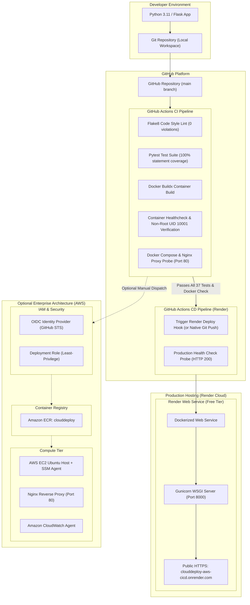

# CloudDeploy - System Architecture & Engineering Specification

## 1. Architectural Overview

**CloudDeploy** is a cloud automation platform designed to deliver containerized web applications reliably to production using modern DevOps, containerization, and Continuous Integration / Continuous Deployment (CI/CD) practices.

The platform implements an automated pipeline from developer commit to a live, secure, production-hosted container environment on **Render Cloud**, while maintaining production-grade **AWS infrastructure artifacts** as an optional enterprise extension.

---

## 2. Production Architecture Flow



---

## 3. Technology Stack Specification

| Tier / Component | Technology | Role & Functionality |
|---|---|---|
| **Web Framework** | Python 3.11 / Flask 3.0.3 | Application factory pattern, structured JSON REST API, telemetry endpoints, and Jinja2 templating. |
| **WSGI Server** | Gunicorn 22.0.0 | Production-grade WSGI server running multiple worker processes with asynchronous worker timeouts and stdout logging. |
| **Testing Suite** | Pytest 8.2.2 + pytest-cov 5.0.0 | Automated unit, route, API, and error-handling test cases achieving **100% statement coverage (359/359 statements)**. |
| **Code Style** | Flake8 7.1.0 | PEP8 formatting and syntax validation enforced with zero allowed violations. |
| **Containerization** | Docker Engine & Dockerfile | Multi-stage, secure container image built on `python:3.11-slim` running as non-root user `clouddeploy` (UID 10001). |
| **Orchestration** | Docker Compose v2 | Multi-container composition linking `clouddeploy-web` and `clouddeploy-nginx` with service health dependencies. |
| **Reverse Proxy** | Nginx Alpine | Edge reverse proxy on port 80 handling buffering, security headers, and CloudWatch-compatible JSON access logs. |
| **CI Automation** | GitHub Actions (`ci.yml`) | Automated checkout, linting, test suite execution, coverage enforcement (>=80%), Docker build, and container runtime probe. |
| **CD Automation** | GitHub Actions (`cd.yml`) | Automated deployment trigger and health verification targeting Render Cloud. |
| **Active Production Host** | Render Cloud (Free Tier) | Live deployment host serving `https://clouddeploy-aws-cicd.onrender.com` with automated Git-push synchronization. |
| **Enterprise Extension** | AWS (ECR, EC2, IAM, SSM, CloudWatch) | Production-ready infrastructure code and bootstrap scripts in `deployment/aws/` for enterprise cloud deployment. |

---

## 4. Container Architecture & Security

### 4.1 Layer Optimization
The `Dockerfile` employs layer caching best practices:
1. System runtime libraries (`ca-certificates`) are installed first.
2. System group and user `clouddeploy` (UID 10001 / GID 10001) are provisioned.
3. `requirements.txt` is copied and installed separately, caching pip layers across code-only changes.
4. Application code is copied and assigned ownership to `clouddeploy:clouddeploy`.
5. Container drops all root privileges via `USER clouddeploy`.

### 4.2 Health Checking
A container healthcheck probe is configured in both `Dockerfile` and `docker-compose.yml`:
```dockerfile
HEALTHCHECK --interval=30s --timeout=5s --start-period=10s --retries=3 \
    CMD python -c "import urllib.request, sys; sys.exit(0 if urllib.request.urlopen('http://localhost:8000/health', timeout=3).getcode() == 200 else 1)"
```

---

## 5. Reverse Proxy Configuration

Nginx acts as the front-facing gateway:
- Routes incoming port 80 traffic to upstream `web:8000`.
- Fast-path routing for `/health` with minimal buffering.
- Injects standard security headers:
  - `X-Frame-Options: SAMEORIGIN`
  - `X-Content-Type-Options: nosniff`
  - `X-XSS-Protection: 1; mode=block`
  - `Referrer-Policy: strict-origin-when-cross-origin`
- Formats access logs in structured JSON for downstream log aggregators.

---

## 6. Real-Time Telemetry & API Integration

The application dashboard dynamically integrates with:
1. **GitHub Actions API (`/api/github/workflows`):** Retrieves live workflow run conclusions, durations, commit SHAs, and branch names with in-memory caching to respect rate limits.
2. **Render Cloud API (`/api/deployments`):** Retrieves deploy records or provides clean integration status for native Git-push deployment.
3. **Consolidated System Monitoring (`/api/monitoring`):** Exposes honest host/container indicators without fabricating resource utilization.
4. **Sanitized In-Memory Logs (`/api/logs`):** Displays real-time application logs with automatic redaction of secret tokens.
